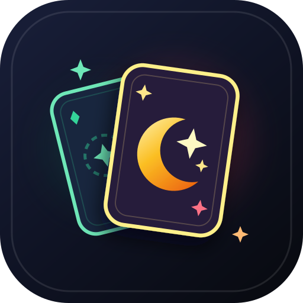
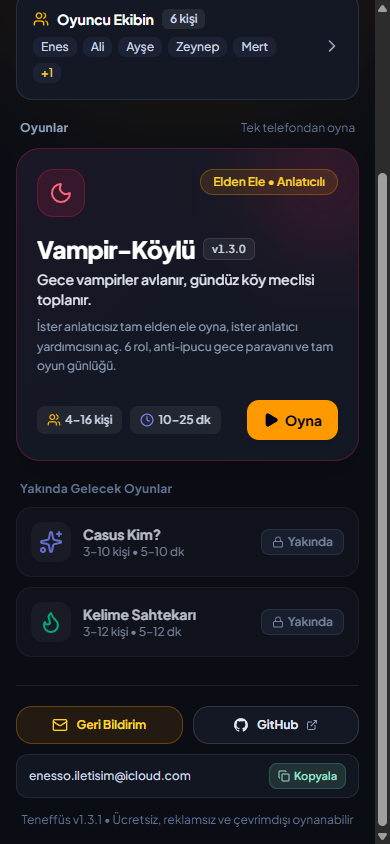
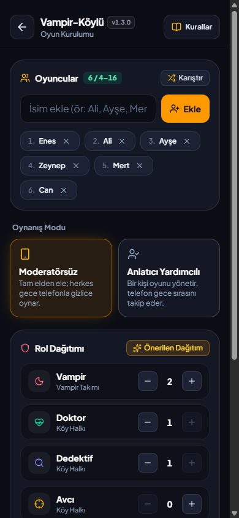

  

  # Teneffüs — Tek Telefondan Elden Ele Parti Oyunları

  **Arkadaş grupları için tasarlanmış; tamamen ücretsiz, reklamsız, çevrimdışı çalışabilen mobil öncelikli pass-and-play parti oyunları hub'ı.**

  
  
  
  
  
  

   

  

    <i>"Kart dağıtma derdine, modası geçmiş kurallara veya internetsiz ortamlarda oyundan kopmaya son! Tek telefonu elden ele dolaştırarak saniyeler içinde oyuna başlayın."</i>
  

   

  <a href="https://teneffus.ns-som.workers.dev/"><strong>Canlı Uygulamayı Hemen Oyna »</strong></a>
    

---

## Ekran Görüntüleri

  <table border="0">
    <tr>
      <td align="center" width="50%">
        
         
        <em>Teneffüs Hub: Ortak Oyuncu Ekibi, Oyun Kartları ve Geri Bildirim Alt Bölümü</em>
      </td>
      <td align="center" width="50%">
        
         
        <em>Vampir-Köylü: Özelleştirilebilir Mod, Rol Dağıtımı ve Oyuncu Listesi</em>
      </td>
    </tr>
  </table>

---

## Neden Teneffüs?

- **Tek Telefon, Elden Ele (Pass-and-Play):** Kimsenin ek uygulama indirmesine veya hesap açmasına gerek kalmadan tek cihazdan oynanır.
- **%100 Ücretsiz & Reklamsız:** Oyun akışını bölen reklamlar, abonelikler veya sunucu bağımlılığı yoktur.
- **Çevrimdışı PWA Desteği:** Ana ekrana eklenebilir (`manifest.webmanifest`) ve Service Worker önbelleği sayesinde internet bağlantısı olmadığında da çalışır.
- **Mobil UX Koruması:** Mobilde basılı tutma sırasında metin seçimi/kopyalama menüsünü, istenmeyen yakınlaştırmayı (pinch-zoom / input auto-zoom) ve ekran kaymalarını engelleyen özel dokunmatik koruma katmanıyla gelir.
- **Paylaşılan Oyuncu Ekibi:** Arkadaş grubunuzun isimlerini Hub'da bir kez kaydedin; oyun kurulumuna otomatik aktarılsın ve aktif oyun durumunuz tarayıcı kapanınca bile kaybolmasın.

---

## Mevcut Oyun: Vampir-Köylü (`v1.3.0`)

Masa başı klasiği **Vampir-Köylü**, elden ele mobil deneyime özel mekaniklerle sıfırdan tasarlandı:

- **İki Oynanış Modu:**
  - **Moderatörsüz (Tam Elden Ele):** Anlatıcıya ihtiyaç duymadan herkes telefonla sırayla rolünü görür ve gece eylemini gizlice gerçekleştirir.
  - **Anlatıcı Yardımcılı:** Yönetici gece turu sırasını ve sabah özetini tek ekrandan kontrol eder.
- **6 Farklı Rol:**
  - **Vampir:** Geceleri kurban seçer; birden fazla vampir varsa oy çoğunluğu geçerlidir.
  - **Köylü:** Özel gece gücü yoktur; gece ekranında dışarıdan sürenin belli olmaması için paravan seçimi yapar.
  - **Doktor:** Her gece bir oyuncuyu vampir saldırısına karşı korur.
  - **Dedektif:** Her gece bir oyuncuyu sorgulayarak vampir olup olmadığını anında öğrenir.
  - **Avcı (Ön-Hedefli Sistem):** Her gece değiştirebildiği bir hedef işaretler; gece veya gündüz elendiğinde seçtiği kişiyi de yanında götürür.
  - **Deli:** Gündüz oylamasında kendini astırmayı başarırsa oyunu tek başına kazanır.
- **Tek Turda Rol + 1. Gece Akışı:** İlk gecede oyuncular basılı tutup rolünü öğrendikten hemen sonra aynı ekranda ilk gece eylemini tamamlar; telefonun ikinci kez elden ele dönmesine gerek kalmaz.
- **Anti-İpucu Eşit Yükseklikli Gece Kartları & `(i)` Rol Bilgisi:** Tüm rollerde kompakt kart yüksekliği eşitlenmiştir; paravan seçimleri rolü dışarıdan belli etmez. İhtiyaç halinde `(i)` butonuyla rol açıklamasına anında bakılabilir.
- **Özelleştirilebilir Kurallar & Çift Oylama Modu:**
  - **Açık Masa Oylaması** (telefon masadayken sırayla tek dokunuşla oy verme ve geri alma) veya **Gizli Elden Ele Oylama**.
  - Doktor kendini koruyabilir mi / üst üste aynı kişiyi koruyabilir mi, ilk gece vampir öldürebilir mi, elenen kişinin rolü açıklansın mı, gündüz tartışma sayacı süresi gibi kurallar kurulumda özelleştirilebilir.

---

## Teknoloji Yığını & Mühendislik Özeti

| Katman | Seçilen Teknoloji & Yaklaşım |
| :--- | :--- |
| **Arayüz** | React 19, TypeScript (strict), Tailwind CSS v4, Lucide İkonları |
| **Derleme & Test** | Vite 8, Vitest (19 saf motor birim testi), ESLint |
| **Mimari** | Oyun motorunun UI'dan izole edildiği Registry tabanlı modüler yapı ([Architecture Docs](docs/ARCHITECTURE.md)) |
| **Veri & Gizlilik** | `%100` tarayıcı içi (`localStorage`), sıfır sunucu / sıfır takip ([Privacy Policy](docs/PRIVACY.md)) |
| **Yayınlama & CDN** | PWA Service Worker + Cloudflare Workers Static Assets (SPA fallback, sınırsız statik istek) |

---

## English Overview (CV & Portfolio Summary)

**Teneffüs** is a mobile-first, offline-capable Turkish pass-and-play party game hub built with **React 19**, **strict TypeScript**, **Tailwind CSS v4**, and **Vite 8**, deployed on **Cloudflare Workers Static Assets** (`https://teneffus.ns-som.workers.dev`).

- **Decoupled Game Engine:** Pure functional TypeScript state transitions for *Vampir-Köylü* (4–16 players, 6 roles, customizable rulesets, open-table & secret voting, night/day phases) covered by **19 Vitest unit tests** independently of React components.
- **Pass-and-Play Security & Mobile Polish:** Equal-height anti-leakage role banners, hold-to-reveal privacy shields, decoy night actions to normalize turn durations, and touch guards preventing accidental text selection or mobile zoom during group handoffs.
- **Zero-Backend PWA:** Offline app-shell caching via a custom Service Worker and persistent local game state (`localStorage`) with shared cross-game player rosters.

*(Note: Application source code is hosted in a private repository; this public repository serves as the project showcase, technical documentation, changelog, and issue tracker.)*

---

## Yol Haritası

Yeni elden ele parti oyunları Hub mimarisine modüler olarak eklenmeye devam edecektir:
- **Casus Kim?** (3–10 kişi, mekân temelli çapraz sorgu oyunu)
- **Kelime Sahtekarı** (3–12 kişi, gizli kelime ve blöf oyunu)

Detaylı plan için [ROADMAP.md](ROADMAP.md) dosyasına göz atabilirsiniz.

---

## Geri Bildirim & İletişim

Hata bildirimi, yeni oyun önerisi veya iş birliği için doğrudan ulaşabilirsiniz:

- **E-posta:** [`enesso.iletisim@icloud.com`](mailto:enesso.iletisim@icloud.com?subject=Teneff%C3%BCs%20Geri%20Bildirim)
- **Öneri & Hata Bildirimi:** [GitHub Issues](https://github.com/Enes-Somuncular/teneffus-public/issues)
- **Canlı Uygulama:** [https://teneffus.ns-som.workers.dev](https://teneffus.ns-som.workers.dev)
