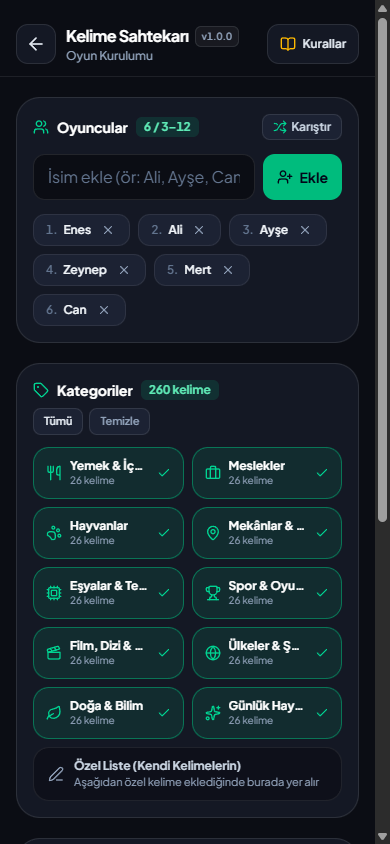

  

  # Teneffüs — Tek Telefondan Elden Ele Parti Oyunları

  **Arkadaş grupları için tasarlanmış; tamamen ücretsiz, reklamsız, çevrimdışı çalışabilen mobil öncelikli pass-and-play parti oyunları hub'ı.**

  
  
  
  
  
  
  

   

  

    <i>"Kart dağıtma derdine, modası geçmiş kurallara veya internetsiz ortamlarda oyundan kopmaya son! Tek telefonu elden ele dolaştırarak saniyeler içinde oyuna başlayın."</i>
  

   

  <a href="https://teneffus.ns-som.workers.dev/"><strong>Canlı Uygulamayı Hemen Oyna »</strong></a>
    

---

## Ekran Görüntüleri

  <table border="0">
    <tr>
      <td align="center" width="33%">
        
         
        <em>Teneffüs Hub v1.4.0: Ortak Oyuncu Ekibi, Vampir-Köylü ve Kelime Sahtekarı</em>
      </td>
      <td align="center" width="33%">
        
         
        <em>Vampir-Köylü v1.3.0: Mod, Rol Dağıtımı ve Kurallar</em>
      </td>
      <td align="center" width="33%">
        
         
        <em>Kelime Sahtekarı v1.0.0: 10 Kategori, Özel Liste ve Son Şans Modları</em>
      </td>
    </tr>
  </table>

---

## Neden Teneffüs?

- **Tek Telefon, Elden Ele (Pass-and-Play):** Kimsenin ek uygulama indirmesine veya hesap açmasına gerek kalmadan tek cihazdan oynanır.
- **%100 Ücretsiz & Reklamsız:** Oyun akışını bölen reklamlar, abonelikler veya sunucu bağımlılığı yoktur.
- **Çevrimdışı PWA Desteği:** Ana ekrana eklenebilir (`manifest.webmanifest`) ve Service Worker önbelleği sayesinde internet bağlantısı olmadığında da çalışır.
- **Mobil UX Koruması:** Mobilde basılı tutma sırasında metin seçimi/kopyalama menüsünü, istenmeyen yakınlaştırmayı (pinch-zoom / input auto-zoom) ve ekran kaymalarını engelleyen özel dokunmatik koruma katmanıyla gelir.
- **Paylaşılan Oyuncu Ekibi:** Arkadaş grubunuzun isimlerini Hub'da bir kez kaydedin; tüm oyun kurulumlarına otomatik aktarılsın ve devam eden oyunlarınız tarayıcı kapanınca bile kaybolmasın.

---

## Oynanabilir Oyunlar

### 1. Kelime Sahtekarı (`v1.0.0` • 3–12 Kişi • 5–12 dk)
Herkesin aynı gizli kelimeyi bildiği, sahtekarların ise blöf yaptığı tek kelimelik ipucu ve çıkarım oyunu:
- **10 Hazır Kategori • 260 Kürasyonlu Kelime:** *Yemek & İçecek*, *Meslekler*, *Hayvanlar*, *Mekânlar & Yerler*, *Eşyalar & Teknoloji*, *Spor & Oyunlar*, *Film, Dizi & Kültür*, *Ülkeler & Şehirler*, *Doğa & Bilim*, *Günlük Hayat & Kavramlar* — tek veya çoklu seçim desteğiyle.
- **Özel Kelime Listesi:** Kendi arkadaş grubunuza veya sınıfınıza özel kelimeler ekleyip cihazınızda saklayabilirsiniz.
- **4 Farklı "Son Şans (Oyunu Çalma)" Modu:** Yakalanan sahtekar gizli kelimeyi **6 Şıklı** seçimden bulabilir, **Yazarak** (büyük/küçük harf ve Türkçe karakter toleranslı) tahmin edebilir, **Sözlü (Masa Onaylı)** söyleyebilir ya da bu kural tamamen **Kapalı** oynanabilir.
- **Eşit Yükseklikli Anti-İpucu Kartları & Özelleştirilebilir Zorluk:** Bilen ve Sahtekar kartları aynı yüksekliğe sahiptir; sahtekara kategori veya zayıf çağrışım ipucu gösterme, birden fazla sahtekarın birbirini görmesi, Açık Masa / Gizli oylama ve tekrarsız kelime havuzu ayarlanabilir.

### 2. Vampir-Köylü (`v1.3.0` • 4–16 Kişi • 10–25 dk)
Masa başı klasiği **Vampir-Köylü**, elden ele mobil deneyime özel mekaniklerle sıfırdan tasarlandı:
- **İki Oynanış Modu:** Tam elden ele **Moderatörsüz** mod veya tek ekrandan akışı yöneten **Anlatıcı Yardımcılı** mod.
- **6 Farklı Rol:** *Vampir*, *Köylü*, *Doktor*, *Dedektif*, her gece hedef güncelleyebilen ön-hedefli *Avcı* ve gündüz asılırsa tek başına kazanan *Deli*.
- **Tek Turda Rol + 1. Gece Akışı & Eşit Kartlar:** İlk gecede oyuncular basılı tutup rolünü öğrendikten hemen sonra eylemini tamamlar; paravan seçimleri ve `(i)` rol bilgi kartıyla süreden rol tahmini engellenir.
- **Özelleştirilebilir Kurallar & Çift Oylama Modu:** **Açık Masa Oylaması** (geri almalı) veya **Gizli Oylama**, elenen rolünü gizleme/gösterme ve doktor kuralları özelleştirilebilir.

---

## Teknoloji Yığını & Mühendislik Özeti

| Katman | Seçilen Teknoloji & Yaklaşım |
| :--- | :--- |
| **Arayüz** | React 19, TypeScript (strict), Tailwind CSS v4, Lucide İkonları |
| **Derleme & Test** | Vite 8, Vitest (29 saf motor birim testi: 19 Vampir-Köylü + 10 Kelime Sahtekarı), ESLint |
| **Mimari** | Oyun motorlarının UI'dan izole edildiği Registry tabanlı modüler yapı ([Architecture Docs](docs/ARCHITECTURE.md)) |
| **Veri & Gizlilik** | `%100` tarayıcı içi (`localStorage`), sıfır sunucu / sıfır takip ([Privacy Policy](docs/PRIVACY.md)) |
| **Yayınlama & CDN** | PWA Service Worker + Cloudflare Workers Static Assets (SPA fallback, sınırsız statik istek) |

---

## English Overview (CV & Portfolio Summary)

**Teneffüs** is a mobile-first, offline-capable Turkish pass-and-play party game hub built with **React 19**, **strict TypeScript**, **Tailwind CSS v4**, and **Vite 8**, deployed on **Cloudflare Workers Static Assets** (`https://teneffus.ns-som.workers.dev`).

- **Multi-Game Modular Architecture:** Hosts both **Vampir-Köylü** (`v1.3.0`, 4–16 players, 6 roles) and **Kelime Sahtekarı** (`v1.0.0`, 3–12 players, 10 categories / 260 curated Turkish words + custom word lists + multiple-choice, Turkish-normalized typed, and verbal steal mechanics) behind a unified plugin-style game registry and shared persistent roster.
- **Decoupled Game Engines:** Pure functional TypeScript state machines for every game, verified by **29 Vitest unit tests** independently of React components.
- **Pass-and-Play Security & Mobile Polish:** Uniform-height anti-leakage cards, hold-to-reveal privacy shields, decoy night actions to normalize turn durations, and touch guards preventing accidental text selection or mobile zoom during group handoffs.
- **Zero-Backend PWA:** Offline app-shell caching via a custom Service Worker and persistent localStorage game state.

*(Note: Application source code is hosted in a private repository; this public repository serves as the project showcase, technical documentation, changelog, and issue tracker.)*

---

## Yol Haritası

Yeni elden ele parti oyunları Hub mimarisine modüler olarak eklenmeye devam edecektir:
- **Casus Kim?** (3–10 kişi, mekân temelli çapraz sorgu oyunu)

Detaylı plan için [ROADMAP.md](ROADMAP.md) dosyasına göz atabilirsiniz.

---

## Geri Bildirim & İletişim

Hata bildirimi, yeni oyun önerisi veya iş birliği için doğrudan ulaşabilirsiniz:

- **E-posta:** [`enesso.iletisim@icloud.com`](mailto:enesso.iletisim@icloud.com?subject=Teneff%C3%BCs%20Geri%20Bildirim)
- **Öneri & Hata Bildirimi:** [GitHub Issues](https://github.com/Enes-Somuncular/teneffus-public/issues)
- **Canlı Uygulama:** [https://teneffus.ns-som.workers.dev](https://teneffus.ns-som.workers.dev)
